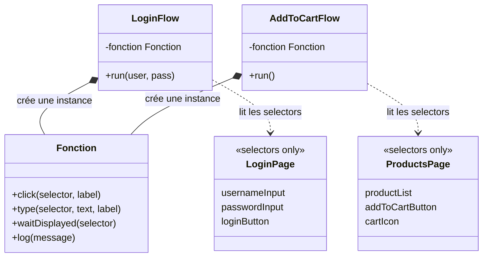
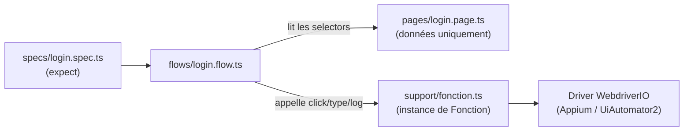

# TP Appium · WebdriverIO · TypeScript

> Projet fil rouge pour monter en compétence sur l'automatisation mobile. Stack : **Appium 2 + WebdriverIO + Mocha + TypeScript**. App support : **Sauce Labs "My Demo App"** (Android, open source).

---

## 0. Lexique — avant de coder

Tu connais déjà JS/TS, mais pas forcément ce vocabulaire du test automatisé :

| Terme | Explication simple |
|---|---|
| **Driver** | L'objet qui pilote réellement l'app (ouvrir, cliquer, lire un texte). |
| **Selector / Locator** | La façon de "trouver" un élément à l'écran (par id, par texte...). C'est ce que tu vas relever avec Appium Inspector. |
| **Appium Inspector** | Outil graphique qui se connecte à l'app en cours d'exécution et te montre l'arbre des éléments + leurs locators. |
| **Page** | Un fichier = un écran de l'app. Il ne contient QUE les selectors de cet écran. Pas d'action, pas de logique. |
| **Fonction** *(notre fichier utilitaire)* | Une classe qui regroupe les actions bas niveau robustes et réutilisables : `click()`, `type()`, `waitDisplayed()`, `log()`. C'est la seule couche qui parle vraiment au driver. |
| **Flow** | Un scénario métier réutilisable (ex: "se connecter", "ajouter un produit au panier"). Il crée une instance de `Fonction`, utilise les selectors d'une page, et enchaîne les étapes. Pas d'assertion dedans. |
| **Spec** | Le fichier de test Mocha. Décrit **un cas de test** : il appelle un flow, puis vérifie le résultat avec `expect()`. |
| **Émulateur** | Un téléphone Android virtuel sur ton PC, créé avec Android Studio, sur lequel Appium installe et pilote l'app. |

---

## 1. Installation — sources officielles

| # | Outil | Pourquoi | Source officielle |
|---|---|---|---|
| 1 | **Node.js** (LTS) | Fait tourner WebdriverIO/Mocha | https://nodejs.org/ |
| 2 | **Java JDK** (Temurin) | Requis par le SDK Android et par Appium | https://adoptium.net/ |
| 3 | **Android Studio** | Fournit le SDK Android + l'émulateur | https://developer.android.com/studio |
| 4 | **Appium 2** + driver UiAutomator2 | Le serveur qui pilote l'app Android | https://appium.io/docs/en/latest/quickstart/install/ et https://appium.io/docs/en/latest/quickstart/uiauto2-driver/ |
| 5 | **Appium Inspector** | Outil graphique pour trouver les locators | https://github.com/appium/appium-inspector/releases |
| 6 | **WebdriverIO + TypeScript + Mocha** | Le framework de test (assistant officiel) | https://webdriver.io/docs/gettingstarted et https://webdriver.io/docs/typescript |
| 7 | **My Demo App** (APK Android) | L'app sur laquelle on s'entraîne | https://github.com/saucelabs/my-demo-app-android/releases |

Vérification de l'environnement :

```bash
npm install -g appium
appium driver install uiautomator2
appium-doctor --android
```

Création du projet (répondre TypeScript + Mocha aux questions de l'assistant) :

```bash
npm init wdio@latest .
```

---

## 2. Arborescence du projet

```
tp-appium-wdio/
├── config/
│   └── wdio.conf.ts
├── pages/                      # 3 fichiers, QUE des selectors
│   ├── login.page.ts
│   ├── products.page.ts
│   └── checkout.page.ts
├── flows/                      # Scénarios métier réutilisables
│   ├── login.flow.ts
│   └── addToCart.flow.ts
├── specs/                      # 1 fichier = 1 cas de test, seul endroit avec des expect()
│   ├── login.spec.ts
│   └── cart.spec.ts
├── support/
│   └── fonction.ts             # classe Fonction : click(), type(), waitDisplayed(), log()
├── tsconfig.json
├── package.json
└── README.md
```

---

## 3. Rôle de chaque couche (règle stricte)

| Dossier | Contient | Ne contient PAS |
|---|---|---|
| `pages/` | Uniquement des **selectors** (objet simple : `{ usernameInput: '...' }`) | Aucune action, aucune méthode, n'importe jamais `fonction.ts` |
| `support/fonction.ts` | La classe `Fonction` : actions bas niveau (`click`, `type`, `waitDisplayed`, `log`) | Aucun selector en dur, aucune logique métier |
| `flows/` | Une classe qui crée une instance de `Fonction` et qui importe les selectors d'une **page** pour construire un scénario réutilisable (`run()`) | Aucun `expect()`, aucun héritage de `Fonction` |
| `specs/` | Un cas de test Mocha : instancie un flow, l'exécute, puis vérifie le résultat | Aucun selector en dur, aucun appel direct au driver |

**Point clé :** les `pages` ne parlent jamais à `Fonction`. C'est le **flow** qui fait le lien : il crée sa propre instance de `Fonction`, prend les selectors de la page et les passe à ses méthodes.

---

## 4. Comment les couches s'appellent entre elles





### Exemple minimal (illustratif)

```ts
// pages/login.page.ts — QUE des selectors, rien d'autre
export const LoginPage = {
  usernameInput: '~nameET',
  passwordInput: '~passwordET',
  loginButton: '~loginBtn',
};

// support/fonction.ts
export class Fonction {
  async click(selector: string, label: string) {
    const el = await $(selector);
    await el.waitForDisplayed();
    this.log(`Clic sur ${label}`);
    await el.click();
  }
  async type(selector: string, text: string, label: string) {
    const el = await $(selector);
    await el.waitForDisplayed();
    this.log(`Saisie dans ${label}`);
    await el.setValue(text);
  }
  log(message: string) {
    console.log(`[TEST] ${message}`);
  }
}

// flows/login.flow.ts — crée une instance de Fonction et utilise les selectors de la page
import { Fonction } from '../support/fonction';
import { LoginPage } from '../pages/login.page';

export class LoginFlow {
  private fonction = new Fonction();

  async run(user: string, pass: string) {
    this.fonction.log('Début du flow de connexion');
    await this.fonction.type(LoginPage.usernameInput, user, 'champ utilisateur');
    await this.fonction.type(LoginPage.passwordInput, pass, 'champ mot de passe');
    await this.fonction.click(LoginPage.loginButton, 'bouton connexion');
  }
}

// specs/login.spec.ts — le seul endroit avec des expect()
import { LoginFlow } from '../flows/login.flow';

describe('Connexion', () => {
  it("permet à l'utilisateur de se connecter", async () => {
    await new LoginFlow().run('bod@example.com', '10203040');
    await expect($('~menuIV')).toBeDisplayed();
  });
});
```

---

## 5. Les 2 cas de test à automatiser

Ces deux cas de test sont **vérifiés sur le code source réel de l'app** (dépôt GitHub `saucelabs/my-demo-app-android`) — les id ci-dessous existent vraiment, à toi de confirmer leur forme exacte (`~id`, `android=...`) avec Appium Inspector.

### Cas de test 1 — Connexion depuis le menu

| | |
|---|---|
| **Préconditions** | App lancée, utilisateur non connecté |
| **Étapes** | 1. Ouvrir le menu latéral (icône `menuIV`)<br>2. Faire défiler la liste (`menuRV`) et sélectionner l'entrée **"Login"**<br>3. Saisir un email dans le champ username (`nameET`), ex: `bod@example.com`<br>4. Saisir un mot de passe dans le champ password (`passwordET`), ex: `10203040`<br>5. Cliquer sur le bouton **Login** (`loginBtn`) |
| **Résultat attendu** | Retour à l'écran principal (icône menu `menuIV` à nouveau visible). En rouvrant le menu, l'entrée affiche désormais **"Logout"** au lieu de "Login" |
| **→ Fichier à produire** | `specs/login.spec.ts`, qui appelle `LoginFlow.run()` |

### Cas de test 2 — Ajouter un produit au panier

| | |
|---|---|
| **Préconditions** | App lancée, écran catalogue affiché |
| **Étapes** | 1. Dans la liste de produits (`productRV`), cliquer sur le premier article<br>2. Vérifier que le titre produit affiché (`productTV`) est **"Sauce Labs Backpack"**<br>3. Cliquer sur le bouton **+** (`plusIV`) pour passer la quantité à 2<br>4. Cliquer sur **Add To Cart** (`cartBt`)<br>5. Ouvrir le panier (`cartRL`) |
| **Résultat attendu** | Le panier affiche "Sauce Labs Backpack" avec une quantité de 2 |
| **→ Fichier à produire** | `specs/cart.spec.ts`, qui appelle `AddToCartFlow.run()` |

---

## 6. Déroulé — projet fil rouge sur 5 jours

**Un seul projet, qui grandit chaque jour.** On ne jette rien d'un jour sur l'autre : chaque jour ajoute une couche au-dessus de ce qui existe déjà, jusqu'à obtenir les 2 specs finaux du point 5.

### Jour 1 — Découverte & premier script (sans structure)
Objectif : prouver que la chaîne d'outils fonctionne, avant d'imposer une architecture.
1. Installer Appium, Appium Inspector, l'émulateur Android (section 1), puis installer l'APK My Demo App dessus.
2. Explorer l'app à la main : catalogue de produits, menu latéral, écran "Login".
3. Ouvrir Appium Inspector connecté à l'app, cliquer sur le menu puis sur un produit, **noter dans un fichier texte** les locators trouvés pour `menuIV`, `productRV`, `productTV`, `plusIV`, `cartBt`.
4. Initialiser le projet : `npm init wdio@latest .` (TypeScript + Mocha).
5. Écrire **un seul fichier** dans `specs/`, sans structure, qui : lance l'app, clique sur le 1er produit, clique sur "Add To Cart", vérifie que le panier contient 1 article.

**Livrable du jour :** ce test passe en vert (`npx wdio run config/wdio.conf.ts`).

### Jour 2 — Page Object Model (selectors uniquement)
Objectif : sortir tous les locators du Jour 1 dans des fichiers `pages/`, sans aucune logique.
1. Créer `pages/products.page.ts` (objet avec `menuIcon`, `productList`, `productTitle`, `increaseQtyButton`, `addToCartButton`, `cartIcon`).
2. Créer `pages/login.page.ts` (objet avec `usernameInput`, `passwordInput`, `loginButton`, `loginMenuEntry`).
3. Créer `pages/checkout.page.ts` vide pour l'instant (réservé plus tard si besoin).
4. Réécrire le spec du Jour 1 pour utiliser les selectors importés depuis `products.page.ts` au lieu des chaînes en dur (le spec appelle encore `$()`/`.click()` directement à ce stade, c'est normal).

**Livrable du jour :** même test, toujours vert, plus aucun locator en dur dans `specs/`.

### Jour 3 — La classe Fonction
Objectif : centraliser les actions bas niveau pour ne plus jamais toucher le driver ailleurs.
1. Créer `support/fonction.ts` avec la classe `Fonction` : `click()`, `type()`, `waitDisplayed()`, `log()`.
2. Réécrire le spec du Jour 2 pour n'appeler que des méthodes de `Fonction` (plus de `$()`/`.click()` direct dans `specs/`).

**Livrable du jour :** même test, toujours vert, logs visibles dans la console à l'exécution.

### Jour 4 — Les flows
Objectif : sortir la logique du spec dans un flow réutilisable, qui relie une page (selectors) et `Fonction` (actions).
1. Créer `flows/addToCart.flow.ts` : `class AddToCartFlow` avec une propriété `private fonction = new Fonction()`, importe `products.page.ts`, expose `run()`.
2. Créer `flows/login.flow.ts` : `class LoginFlow` avec une propriété `private fonction = new Fonction()`, importe `login.page.ts`, expose `run(username, password)`.
3. Réécrire les specs pour qu'ils appellent uniquement `new AddToCartFlow().run()` / `new LoginFlow().run(...)`, puis fassent les `expect()`.

**Livrable du jour :** 2 specs < 10 lignes chacun, qui appellent un flow puis assertent.

### Jour 5 — Finaliser les 2 cas de test + revue
Objectif : faire correspondre exactement `specs/login.spec.ts` et `specs/cart.spec.ts` aux 2 cas de test de la section 5 (étapes + résultat attendu).
1. Ajuster `LoginFlow`/`AddToCartFlow` si besoin pour coller exactement aux étapes décrites.
2. Ajouter les assertions manquantes (ex: vérifier "Logout" après connexion, vérifier la quantité dans le panier).
3. Revue de code avec le mentor : zéro appel driver hors `fonction.ts`, zéro selector en dur hors `pages/`, flows bien réutilisés, specs lisibles comme les cas de test.

**Livrable final :** les 2 specs passent en vert et correspondent mot pour mot aux cas de test de la section 5.
